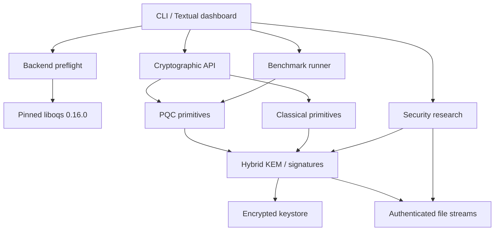

# Post-Quantum Cryptography Lab

A Linux-first research lab for standardized post-quantum cryptography, hybrid key establishment and signatures, authenticated file encryption, adversarial security experiments, and performance benchmarking.

**Platform:** Ubuntu 24.04 / WSL2 · Linux x86_64 · Python 3.12

**Native backend:** liboqs 0.16.0 · liboqs-python 0.16.0.2

**Status:** Research / education software — not production cryptography.

## Highlights

- **Post-quantum algorithms:** ML-KEM-512/768/1024, ML-DSA-44/65/87, and SLH-DSA-SHA2-128s/192s/256s.
- **Hybrid key establishment:** ML-KEM-768 + X25519, combined with HKDF-SHA-256 and transcript/context binding.
- **Hybrid signatures:** ML-DSA-65 + ECDSA-P256; both signatures must verify.
- **Encrypted key storage:** Scrypt-derived AES-256-GCM envelopes with authenticated metadata and owner-only Linux file permissions.
- **Streaming file encryption:** chunked AES-256-GCM, per-record authentication and record-order binding, and a mandatory authenticated final record.
- **Security research:** seven synthetic adversarial scenarios covering tampering, downgrade, key substitution, signature stripping, stream reordering/truncation, and malformed parser inputs.
- **Fuzz testing:** bounded Atheris target for the streaming parser.
- **Benchmarking:** real ML-KEM/ML-DSA operations with raw samples, JSON, CSV, and latency charts.
- **Interactive dashboard:** Textual UI for backend status, algorithm availability, research results, and benchmark telemetry.

## Architecture



The native backend is provisioned explicitly from a pinned upstream commit. Runtime auto-download and compilation are blocked. `pqclab doctor` checks the installed native library, wrapper versions, and required algorithms before cryptographic operations are allowed.

See [architecture](docs/architecture.md), [cryptographic API](docs/crypto-primitives.md), and [dependency provenance](docs/dependencies.md).

## Quick start — Ubuntu / WSL2

Requirements: Linux x86_64, Python 3.12, Git, CMake, GCC, Make, OpenSSL development headers, pkg-config, and [uv 0.13.9](https://docs.astral.sh/uv/).

```bash
sudo apt-get update
sudo apt-get install --yes build-essential cmake git libssl-dev pkg-config

uv python install 3.12
uv sync --locked --extra dev
bash scripts/provision-linux.sh

export OQS_INSTALL_PATH="$PWD/.native/liboqs"
uv run --locked pqclab doctor
```

The provisioner verifies the liboqs 0.16.0 tag against commit `5a1a854b0dc9f2141bdc771c555ee60c37950183`, builds only the project's algorithm allowlist, installs under `.native/liboqs`, and runs the native preflight. It does not use sudo or modify system-wide library paths.

For WSL2, keep the repository inside the Linux filesystem (for example, under `~/projects`) for native build performance.

## Run the lab

```bash
# Run seven synthetic security experiments
OQS_INSTALL_PATH="$PWD/.native/liboqs" uv run --locked pqclab research \
  --output-dir ./research-results

# Benchmark real ML-KEM-768 and ML-DSA-65 operations
OQS_INSTALL_PATH="$PWD/.native/liboqs" uv run --locked --extra benchmark \
  pqclab benchmark --iterations 100 --message-file ./README.md \
  --output-dir ./benchmark-results

# Launch the interactive dashboard
OQS_INSTALL_PATH="$PWD/.native/liboqs" uv run --locked --extra tui --extra benchmark \
  pqclab ui

# Run the full test suite
OQS_INSTALL_PATH="$PWD/.native/liboqs" uv run --locked \
  --extra dev --extra benchmark --extra tui --extra fuzz pytest -q

# Run a bounded parser-fuzz smoke test
OQS_INSTALL_PATH="$PWD/.native/liboqs" uv run --locked --extra fuzz \
  python scripts/fuzz_stream_parser.py -runs=100
```

## Verification evidence

The recorded Ubuntu/WSL2 run on 2026-11-25 reported:

| Check | Result |
|---|---:|
| Automated tests | 83 passed |
| Synthetic security experiments | 7 / 7 passed |
| Malformed parser corpus | 10 / 10 rejected |
| Atheris smoke | 100 executions, no crash |
| Native backend | liboqs 0.16.0 ready |

A short 10-iteration benchmark run on WSL2 produced these median latencies:

| Operation | Algorithm | Median |
|---|---|---:|
| Encapsulation | ML-KEM-768 | 0.0228 ms |
| Decapsulation | ML-KEM-768 | 0.0302 ms |
| Signing | ML-DSA-65 | 0.1970 ms |
| Verification | ML-DSA-65 | 0.1118 ms |

These are environment-specific smoke measurements, not performance guarantees. See the [full report](docs/research-report.md) and raw [JSON](reports/2026-11-25/benchmark/results.json), [CSV](reports/2026-11-25/benchmark/results.csv), and [latency chart](reports/2026-11-25/benchmark/latency.png).

## Project structure

```text
src/pqclab/
  backend.py          Native backend preflight and version checks
  cli.py              doctor, research, benchmark, and ui commands
  crypto/             PQC, classical, hybrid, keystore, and streaming APIs
  research.py         Synthetic adversarial experiments
  benchmark.py        Real-operation benchmark and exports
  tui.py              Interactive Textual dashboard
  file_security.py    Owner-only files and atomic output helpers
tests/                Unit and integration tests
scripts/              Linux native provisioning and bounded fuzz runner
docs/                 Architecture, API, research, and deployment notes
reports/              Reproducible benchmark and research artifacts
```

## CV-ready project summary

**Post-Quantum Cryptography Lab | Python, liboqs, OpenSSL, Linux**

- Built a Linux-based PQC research toolkit using ML-KEM, ML-DSA, and SLH-DSA with a pinned Open Quantum Safe native backend.
- Implemented hybrid ML-KEM-768/X25519 key establishment and ML-DSA-65/ECDSA-P256 dual signatures with transcript-bound key derivation and mandatory dual verification.
- Developed Scrypt/AES-256-GCM encrypted key storage and authenticated chunked file encryption with tamper and truncation detection.
- Added seven adversarial security experiments, bounded parser fuzzing, real-operation benchmarks, and an interactive Textual dashboard; verified with 83 automated tests on Ubuntu/WSL2.

## Security scope

This is a research and education project, not a production cryptographic product or FIPS-validated module. It has not undergone formal protocol proof, independent cryptographic audit, constant-time review, physical side-channel testing, secure-deletion assessment, or memory-zeroization assessment. Do not use it to protect sensitive production data.
