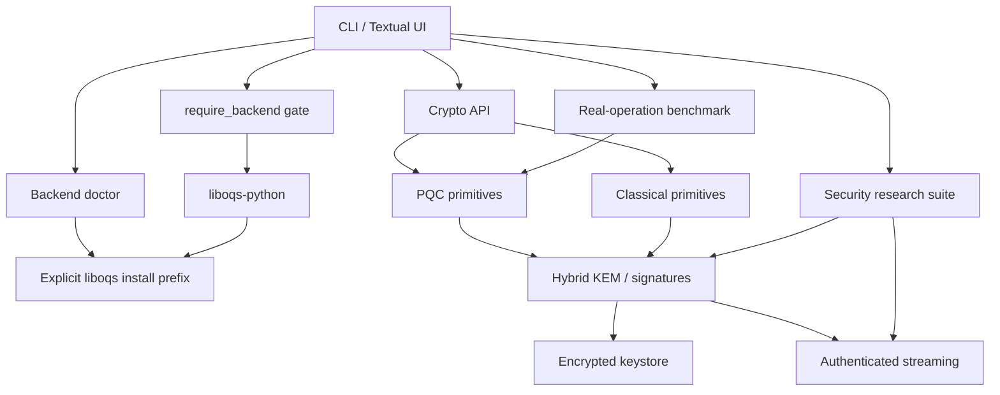

# Architecture and execution flow

## Runtime boundary

`pqclab.cli` exposes four commands: `doctor`, `benchmark`, `research` and `ui`.

`backend.doctor()` inspects the explicitly provisioned native library and runtime metadata without importing the liboqs Python wrapper. `backend.require_backend()` is the gated import boundary: it blocks wrapper auto-provisioning, sets `OQS_INSTALL_PATH`, imports only after preflight, and verifies the loaded native path and pinned version.

## Cryptographic layers

- `crypto/kem.py`: allowlisted ML-KEM key generation, encapsulation and decapsulation.
- `crypto/signatures.py`: allowlisted ML-DSA and SLH-DSA signing/verification.
- `crypto/classical.py`: X25519/P-256 ECDH, ECDSA-P256 and RSA-3072 OAEP/PSS.
- `crypto/hybrid.py`: ML-KEM + X25519 key establishment; transcript/context binding and HKDF-SHA-256 combine both independent secrets.
- `crypto/hybrid_signatures.py`: ML-DSA + ECDSA signatures over one domain-separated context-bound payload; both verifications are required.
- `crypto/fingerprints.py`: domain-separated SHA-256 fingerprints of hybrid public keys.
- `crypto/keystore.py`: versioned Scrypt/AES-256-GCM encrypted private-key envelopes.
- `crypto/streaming.py`: chunked AES-256-GCM with per-record AAD, monotonic nonce counter and mandatory authenticated final record.
- `file_security.py`: POSIX owner-only permissions, symlink rejection, identity-checked opens, atomic no-clobber publication and directory durability handling.

## Research and measurement

`research.py` runs seven isolated attack scenarios against newly generated ephemeral keys and synthetic data. It exports only sanitized outcomes and runtime metadata. `fuzzing.py` is the bounded parser target used by Atheris; the optional fuzzer is Linux-only and its hard limits are enforced by `scripts/fuzz_stream_parser.py`.

`benchmark.py` times actual default ML-KEM-768 and ML-DSA-65 operations, self-checks the results, records raw samples and environment metadata, and exports JSON/CSV/PNG artifacts. It does not emit keys or message content.

## User interfaces

The CLI and Textual dashboard call the same public backend/crypto/research/benchmark functions. The dashboard sends CPU/native work to worker threads with `asyncio.to_thread`; the event loop remains responsive. No UI renders private keys, passphrases, shared secrets or plaintext content.

## Deployment

- Linux/WSL2: `scripts/provision-linux.sh` builds the pinned native backend under `.native/liboqs`; Linux CI repeats provisioning, preflight, tests and packaging checks.
