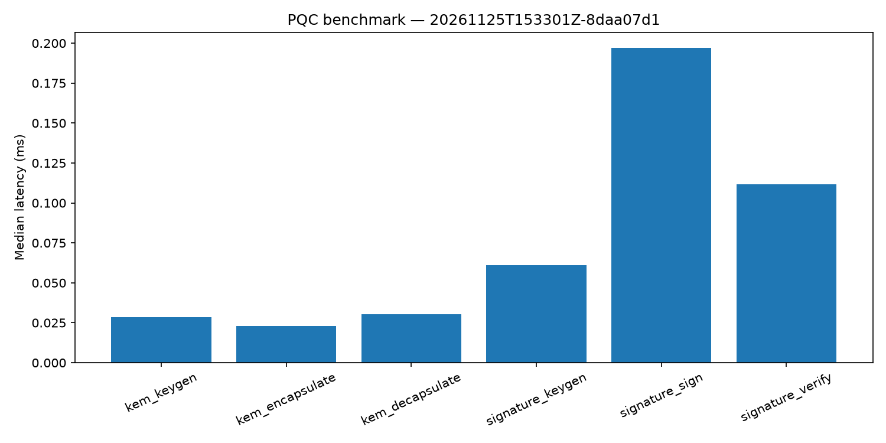

# PQC Lab research and benchmark report

**Run date:** 2026-11-25

**Purpose:** reproducible development evidence for the research lab, not a security certification.

## Environment

| Field | Value |
|---|---|
| Python | 3.12.16 |
| liboqs | 0.16.0 |
| liboqs-python | 0.16.0.2 |
| cryptography | 50.0.2 |
| OS | Ubuntu/WSL2, Linux 6.18.58.1-microsoft-standard-WSL2 |
| Architecture | x86_64 |
| CPU | AMD Ryzen 5 7640HS w/ Radeon 760M Graphics, 6 cores / 12 threads |
| OpenSSL | 4.0.3 |

## Benchmark methodology

The benchmark ran 10 measured iterations for each default operation using real ML-KEM-768 and ML-DSA-65 operations. The message was the repository README (5,484 bytes). The harness records raw nanosecond samples, median/mean latency, mean-derived operations per second, message throughput and public size metadata. It self-checks the KEM shared secret and signature validity.

### Measured results

| Operation | Algorithm | Median latency | Mean-derived ops/s | Public/cipher/signature size |
|---|---|---:|---:|---:|
| Key generation | ML-KEM-768 | 0.0285 ms | 3,786 | Public key 1,184 B; secret key 2,400 B |
| Encapsulation | ML-KEM-768 | 0.0228 ms | 39,574 | Ciphertext 1,088 B |
| Decapsulation | ML-KEM-768 | 0.0302 ms | 21,974 | Ciphertext 1,088 B |
| Key generation | ML-DSA-65 | 0.0611 ms | 13,245 | Public key 1,952 B; secret key 4,032 B |
| Signing | ML-DSA-65 | 0.1970 ms | 4,808 | Signature 3,309 B; message 5,298 B |
| Verification | ML-DSA-65 | 0.1118 ms | 7,955 | Signature 3,309 B; message 5,298 B |

The first key-generation sample was materially slower than the remaining samples, consistent with a cold-start effect. The reported operations/second value uses the arithmetic mean, while the table also shows the median. Ten samples are useful as a smoke measurement, not as a statistically robust performance claim. Results are specific to this WSL2 environment and must not be compared directly with measurements from different CPUs, operating systems, compilers or power states.

### Raw benchmark artifacts

- [JSON with raw samples and environment metadata](../reports/2026-11-25/benchmark/results.json)
- [CSV operation table](../reports/2026-11-25/benchmark/results.csv)
- [Latency chart](../reports/2026-11-25/benchmark/latency.png)

Run ID: `20261125T153301Z-8daa07d1`.

## Security research experiments

The synthetic research suite completed **7/7 scenarios successfully** using newly generated ephemeral keys and synthetic messages.

| Scenario | Result | Observed behavior |
|---|---|---|
| Ciphertext tampering | PASS | ML-KEM implicit rejection produced a receiver secret different from the sender secret |
| Protocol downgrade | PASS | Unsupported version and algorithm substitution rejected (2/2) |
| Recipient-key substitution | PASS | Public-key fingerprint mismatch detected; substituted recipient derived a different secret |
| Hybrid signature stripping | PASS | Removing either ML-DSA or ECDSA caused verification failure |
| Stream chunk reordering | PASS | Reordered authenticated records rejected |
| Stream truncation | PASS | Missing final authentication tag rejected |
| Parser malformed-input corpus | PASS | 10/10 malformed inputs rejected without unhandled parser exceptions |

The bounded Atheris smoke run completed 100 executions with no crash. Its hard caps are 1 MiB input, 8 MiB plaintext, 30 seconds, 512 MiB RSS, 5 seconds per input and 10,000 executions. This smoke run is not equivalent to long-running coverage-guided fuzzing.

### Raw research artifacts

- [Sanitized JSON report](../reports/2026-11-25/security/research.json)
- [Markdown report](../reports/2026-11-25/security/research.md)

Run ID: `20261125T153302Z-89a9a2c1`.

## Interpretation and limitations

- ML-KEM decapsulation uses implicit rejection. A malformed but correctly sized ciphertext may produce a pseudorandom secret instead of raising an exception; the relevant safety property here is that it does not reproduce the sender's secret.
- The hybrid KEM derives a 32-byte key using HKDF-SHA-256 over length-framed independent PQ and classical secrets and binds the transcript/context.
- Hybrid signature verification requires both components; this report does not establish the security of a complete certificate, identity or key-distribution protocol.
- These measurements and experiments do not establish constant-time behavior, resistance to physical side channels, secure deletion, memory zeroization, FIPS validation or production readiness.
- This report records a Linux/WSL2 run only; it does not establish behavior on other operating systems or architectures.
